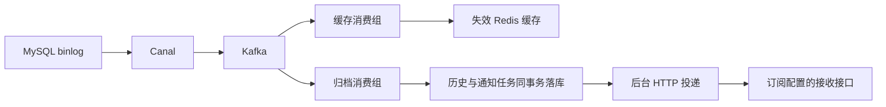

# 数据库变更处理与缓存同步平台

采集 MySQL binlog，一路异步失效 Redis 缓存，另一路归档变更、匹配条件订阅并生成 HTTP 通知任务。提供变更查询、通知排障、历史重放和恢复 SQL 预览页面。

技术栈：Java 17、Spring Boot 3.2、MyBatis-Plus、MySQL 8、Redis 7、Canal 1.1.8、Kafka。



## 主要能力

- **缓存查询与一致性**：`@AutoCache` 登记表与 Key 规则，支持 Pipeline 批读、缺失 ID 批量查库、负缓存与单 JVM 请求合并；加载令牌与 Lua 校验阻止失效后的旧查询重新回填。二级索引缓存（如 `user-email:{email}` 保存主键列表）按修改前后的列值同时失效，回填同样经过加载令牌校验。
- **独立消费进度**：缓存和归档使用不同消费组；缓存批次全部处理成功后确认消费进度，Redis 等外部故障时回到批次起点重试，间隔从 1s 递增到 30s。无法解析或前后镜像都缺主键的事件写入 Redis Stream 死信后跳过，不阻塞分区；死信写入失败则整批重试。
- **表级失效**：已登记表的 TRUNCATE、DROP、RENAME 事件用 SCAN + UNLINK 清空该表的主键与索引缓存命名空间。`GET /cache/dead-letters` 查看死信，`POST /cache/groups/{table}/purge` 手动清空分组。
- **变更归档与通知**：事件与通知任务在同一数据库事务内保存，唯一键去重；后台租约领取、退避重试和人工补发与 Kafka 归档解耦。
- **重放与恢复 SQL**：依据订阅快照重放历史；检查恢复基线、表结构与当前行，生成带当前值条件的逆向 SQL 供预览和导出，由使用者确认后执行。支持整数、DECIMAL、浮点、文本、二进制、BIT、JSON、ENUM/SET、YEAR、DATE、TIME、DATETIME 和 TIMESTAMP。外键表允许恢复未修改关联列的 UPDATE；修改外键关联列，以及外键表的 INSERT、DELETE 恢复仍不支持。生成列、触发器和空间类型暂不支持。结构快照变化后需重新建立基线，新规则适用于基线之后的事件。
- **可选缺货示例**：以库存变更演示下游接收、幂等创建缺货待办和处理状态，按 `stockout-demo` profile 独立启用。

## 快速启动

`platform.binlog-time-zone` 默认 `Asia/Shanghai`，必须与 Canal JVM 格式化 TIMESTAMP 的时区一致，可通过 `CANAL_BINLOG_TIME_ZONE` 配置。恢复 SQL 为 TIMESTAMP 写入 UTC 偏移量，并按 Unix 时间比较当前值；执行连接可以使用不同的会话时区。JSON 需要完整行镜像及完整 JSON 文档。

需要 Java 17、Maven 和 Docker Compose。默认示例端口绑定 `127.0.0.1`，用于本机演示。

```powershell
Copy-Item .env.example .env
# 按本机需要修改 .env
docker compose --profile app up -d --build
```

Compose 启动 MySQL、Redis、Kafka、Canal 和应用，并初始化示例业务表与平台表。首次拉取镜像和构建需要一些时间。

- 应用：`http://localhost:8081`
- 平台页面：`http://localhost:8081/platform-dashboard.html`
- 健康检查：`http://localhost:8081/actuator/health`

默认 Compose 启用平台归档；也可设置 `PLATFORM_ENABLED=false` 仅运行缓存分支。缺货示例的表结构见 `examples/stockout/schema.sql`，运行配置见 `src/main/resources/application-stockout-demo.yml`。

直接运行后端时，可复制 `src/main/resources/application-local.example.yml` 为项目根目录的 `application-local.yml`，并通过环境变量设置数据库、Redis 和 Kafka 地址及密码。

```bash
mvn spring-boot:run -Dspring-boot.run.profiles=local
```

## 两种服务器的量化结果

已在 **2 核 2GB** 和 **4 核 8GB** 两种服务器配置下完成量化测试。

**3 并发、300 个样本的闭环测量：**

| 服务器配置 | Canal 取批 / 等待上限 | 失效 P50 / ms | 失效 P99 / ms |
| --- | --- | ---: | ---: |
| 2 核 2GB | `1 / 5000ms` | 49.856 | 148.416 |
| 4 核 8GB，两轮测试 | `1 / 5000ms` | 14.277–19.628 | 66.366–74.401 |
| 4 核 8GB，高负载优先配置 | `16 / 5ms` | 72.557 | 152.043 |

**优化与持续写入结果：**

| 场景 | 实测结果 |
| --- | --- |
| 2 核 2GB：合并归档事务 | 停写后平均归档追平 13.133s → 3.830s；含追平的有效处理量 26.503 → 36.635 次/秒 |
| 4 核 8GB：32 路短时持续写入，单条配置 | 两轮写入吞吐 995.425、773.712 次/秒，对应失效 P99 为 1666.607、6986.767ms |
| 4 核 8GB：Canal `1 / 5000ms` → `16 / 5ms` | 同轮 32 路写入对照，失效 P99 从 2008.231ms 降至 210.363ms；采用后复测为 278.758ms |
| 同 Key 并发冷读 | 24 个并发 HTTP 查询只触发 1 次 Mapper SELECT |

小批次改善了高负载尾延迟，也增加了低负载等待。

测试方法与完整数据见 [量化说明](docs/performance-quantification.md) 和 [可复算数据](docs/verification/two-server-benchmarks-20261115.json)。

## 代码入口与验证

- `service/`：缓存查询与失效策略。
- `platform/`：变更归档、订阅、投递、重放与恢复。
- `warehouse/`：可选缺货示例。
- `docker/`：本地基础设施配置与初始化 SQL。
- `scripts/`：延迟、吞吐和示例验收脚本。

```bash
mvn verify
```

部分集成测试使用 Testcontainers，需要 Docker。GitHub Actions 使用带 Docker 的 Runner 执行验证。
