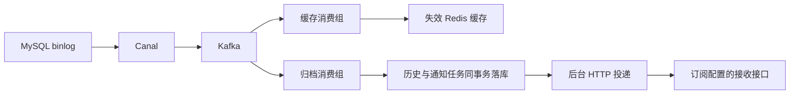

# 数据库变更处理与缓存同步平台

采集 MySQL binlog，一路异步失效 Redis 缓存，另一路归档变更、匹配条件订阅并生成 HTTP 通知任务。提供变更查询、通知排障、历史重放和恢复 SQL 预览页面。

技术栈：Java 17、Spring Boot 3.2、MyBatis-Plus、MySQL 8、Redis 7、Canal 1.1.8、Kafka。



## 主要能力

- **缓存查询与一致性**：`@AutoCache` 登记表与 Key 规则，支持 Pipeline 批读、缺失 ID 批量查库、负缓存与单 JVM 请求合并；加载令牌与 Lua 校验阻止失效后的旧查询重新回填。
- **独立消费进度**：缓存和归档使用不同消费组；缓存批次全部处理成功后确认消费进度，失败回到批次起点重试。
- **变更归档与通知**：事件与通知任务在同一数据库事务内保存，唯一键去重；后台租约领取、退避重试和人工补发与 Kafka 归档解耦。
- **重放与恢复 SQL**：依据订阅快照重放历史；检查恢复基线、表结构与当前行，生成带当前值条件的逆向 SQL 供预览和导出，由使用者确认后执行。
- **可选缺货示例**：以库存变更演示下游接收、幂等创建缺货待办和处理状态，按 `stockout-demo` profile 独立启用。

## 快速启动

需要 Java 17、Maven 和 Docker Compose。默认示例端口绑定 `127.0.0.1`，用于本机演示。

```powershell
Copy-Item .env.example .env
# 按本机需要修改 .env
docker compose --profile app up -d --build
```

Compose 启动 MySQL、Redis、Kafka、Canal 和应用，并初始化示例业务表与平台表。首次拉取镜像和构建需要一些时间。

- 应用：`http://localhost:8081`
- 平台页面：`http://localhost:8081/platform-dashboard.html`
- 健康检查：`http://localhost:8081/actuator/health`

默认 Compose 启用平台归档；也可设置 `PLATFORM_ENABLED=false` 仅运行缓存分支。缺货示例的表结构见 `examples/stockout/schema.sql`，运行配置见 `src/main/resources/application-stockout-demo.yml`。

直接运行后端时，可复制 `src/main/resources/application-local.example.yml` 为项目根目录的 `application-local.yml`，并通过环境变量设置数据库、Redis 和 Kafka 地址及密码。

```bash
mvn spring-boot:run -Dspring-boot.run.profiles=local
```

## 已有量化记录

| 场景 | 记录结果 |
| --- | --- |
| 同 Key 并发冷读 | 24 个并发 HTTP 查询只触发 1 次 Mapper SELECT |
| 停写后的归档追平 | 对应对照中，平均耗时 13.13s → 3.83s |
| 写入至缓存失效 | 2 核 2GB 同机、3 并发、300 次成功修改，P99 为 148.416ms |

环境、对照方法和验证记录见 [验证目录](docs/verification/)。这些数值对应上述测试条件。

## 代码入口与验证

- `service/`：缓存查询与失效策略。
- `platform/`：变更归档、订阅、投递、重放与恢复。
- `warehouse/`：可选缺货示例。
- `docker/`：本地基础设施配置与初始化 SQL。
- `scripts/`：延迟、吞吐和示例验收脚本。

```bash
mvn verify
```

部分集成测试使用 Testcontainers，需要 Docker。GitHub Actions 使用带 Docker 的 Runner 执行验证。
